# Wavstrata

**Estudio de visualización geológica y sonificación que funciona en el navegador.**

Wavstrata convierte superficies del terreno y nubes de puntos en una visualización 3D interactiva y sonido evolutivo. Está diseñado para explorar el sonido y el espacio: permite cargar un modelo, examinar y transformar su forma, experimentar con perfiles sonoros y exportar audio con un archivo complementario de metadatos.

La captura muestra la aplicación con el perfil **Drone oscuro**, 18 voces, un batimiento de 12 centésimas y una anchura estéreo del 82 %.

## Abrir la aplicación

### Versión en línea

[Abrir WAVSTRATA](https://rvx.github.io/wavstrata/Wavstrata.html)

### Catálogo compartido de escaneos 3D

La aplicación en línea incluye un catálogo público con los cinco escaneos de `3DSCANS/`. Selecciona un escaneo y pulsa **Cargar**; la aplicación descarga únicamente ese modelo desde GitHub Pages y lo procesa en el navegador. El catálogo completo ocupa aproximadamente **150 MiB**. Los escaneos son públicos y cualquier persona puede acceder a ellos o descargarlos.

### Uso local

1. Descarga `Wavstrata.html`.
2. Ábrelo con una versión actual de Chrome, Edge o Firefox.
3. Mantén una conexión a Internet para que la página pueda cargar desde sus CDN las bibliotecas de visualización, la interfaz y los iconos.

No se necesita compilar, instalar paquetes, crear una cuenta ni iniciar un servidor.

## Flujo de trabajo

1. Selecciona un escaneo del catálogo público y pulsa **Cargar**, arrastra un modelo local compatible o comienza con uno de los preajustes geológicos.
2. Examina la superficie en el visor 3D. Orbita con el ratón y ajusta la posición XYZ, la rotación de los ejes, los giros rápidos de 45°/90°/180° y los límites de recorte.
3. Configura el motor sonoro: elige uno de los seis perfiles y ajusta la duración, el tono base, la forma de onda, la escala musical, la envolvente ADSR, el filtro (Opción A) y los armónicos (Opción B).
4. Pulsa **Procesar y sonificar geología**. Compara las **Opciones A y B** y reproduce el resultado para escucharlo.
5. Si lo deseas, introduce los metadatos del sitio. Selecciona PCM de 16 o 24 bits y descarga el **WAV** y el **JSON** por separado; ambos archivos comparten el mismo nombre base.

El archivo JSON complementario registra el formato de audio, los ajustes de sonido, el nombre y las transformaciones del modelo, los metadatos del sitio y los ajustes de reverberación usados durante la reproducción. La reverberación de cañón, el filtro de paso bajo y el volumen maestro afectan a la escucha de previsualización, pero no se aplican al WAV exportado.

## Tutorial visual

Esta animación muestra el flujo de uso de Wavstrata: cargar y posicionar un escaneo, configurar el sonido, escucharlo y exportarlo.

Abre la [aplicación Wavstrata](https://rvx.github.io/wavstrata/Wavstrata.html) y sigue estos cinco pasos:

1. **Cargar:** selecciona un modelo del catálogo público y pulsa **Cargar**, o arrastra un archivo OBJ, STL, PLY ASCII o XYZ.
2. **Posicionar:** orbita con el ratón, ajusta X/Y/Z y usa los botones de giro para alinear los estratos. **Encuadrar** vuelve a centrar el modelo.
3. **Configurar:** selecciona un perfil y experimenta con el tono, la duración, la forma de onda, la escala, la envolvente, el filtro y la cantidad de armónicos. Para empezar, prueba con una duración corta.
4. **Escuchar:** pulsa **Procesar y sonificar geología**, compara las vistas **Opción A** y **Opción B** y reproduce el resultado. La reverberación, el filtro de paso bajo y el volumen afectan a la previsualización, no al WAV exportado.
5. **Exportar:** selecciona la profundidad PCM y descarga el **WAV** y el **JSON** por separado. El JSON incluye los ajustes y los metadatos del sitio que hayas completado.

Los perfiles disponibles son **Terreno**, **Drone estratigráfico**, **Drone oscuro**, **Abismo**, **Pulso tectónico** y **Coro mineral**.

## Funciones

- Visor interactivo 3D de terreno y nubes de puntos basado en Three.js.
- Vista de nube de puntos diferenciada. Las mallas densas se muestrean para su visualización; la geometría de resolución completa se conserva para la vista de superficie y la sonificación.
- Catálogo público de cinco escaneos OBJ; cada modelo se descarga individualmente desde GitHub Pages.
- Indicadores de carga destacados con porcentaje y tamaño descargado para los escaneos del catálogo; la interpretación y el renderizado de audio muestran su etapa actual.
- Compatibilidad con archivos OBJ, STL, PLY y XYZ; los archivos PLY deben estar en formato ASCII.
- Seis perfiles de sonificación: Terreno, Drone estratigráfico, Drone oscuro, Abismo, Pulso tectónico y Coro mineral.
- Controles de previsualización de audio, reverberación de cañón con ajustes de mezcla, predemora y decaimiento, y filtro de paso bajo.
- Exportación WAV PCM de 16 y 24 bits y descarga por separado de su archivo JSON complementario con metadatos.
- Metadatos del sitio guardados en el navegador y exportables como JSON.

## Privacidad y notas prácticas

- Wavstrata no tiene servidor propio ni sistema de analítica. Los modelos se procesan en el navegador; los metadatos del sitio se guardan en el almacenamiento local de ese navegador, salvo que se exporten. Los cinco escaneos de `3DSCANS/` están alojados públicamente en GitHub Pages.
- La página carga bibliotecas de terceros y fuentes desde CDN, por lo que necesita conexión a Internet. Evita introducir información confidencial en un dispositivo compartido.
- Los archivos de geometría grandes y las síntesis de drones largas y de alta resolución requieren más memoria y capacidad de procesamiento. Si el dispositivo tiene dificultades, empieza con un preajuste o una duración más corta.
- El WAV contiene el búfer de síntesis generado. Los controles que solo afectan a la reproducción —como la reverberación de cañón, el filtro de paso bajo y el volumen maestro— no se incorporan al audio exportado. El archivo JSON complementario sí registra los ajustes de reverberación.

## Archivos

- `Wavstrata.html` — aplicación independiente.
- `wavstrata-screenshot.png` — captura de la aplicación.
- `wavstrata-tutorial.svg` — guía visual animada del flujo de trabajo principal.
- `README.md` — instrucciones de uso e información de GitHub Pages.
- `3DSCANS/` — catálogo público de escaneos OBJ y su índice `catalog.json`.

## Contribuciones

Se agradecen los informes de problemas y las solicitudes de cambios. Este proyecto pretende ser una implementación de referencia pequeña y legible para convertir escaneos 3D en sonido, no un framework completo. Puedes crear una bifurcación, adaptarla a otros escaneos o ampliar el enfoque de sonificación (por ejemplo, con estiramiento temporal que conserve el tono o mezclas estéreo multicanal).

## Cita

Si esta herramienta te resulta útil en un contexto académico o creativo, se agradece una cita o mención similar a la siguiente:

    Mazon, V. (2026). Wavstrata: superficies geológicas, metadatos espaciales, sonificación y Toolkit [Software].

## Licencia

Este proyecto está publicado bajo la Licencia Pública General de GNU, versión 3.0 (GPL-3.0); consulta el texto completo en `LICENSE`. En resumen: puedes usar, estudiar, modificar y redistribuir este software (incluso con fines comerciales), siempre que las obras derivadas también se publiquen bajo la GPL-3.0 y se conserven los avisos de derechos de autor y licencia.

Copyright (C) 2026 Victor Mazon.
