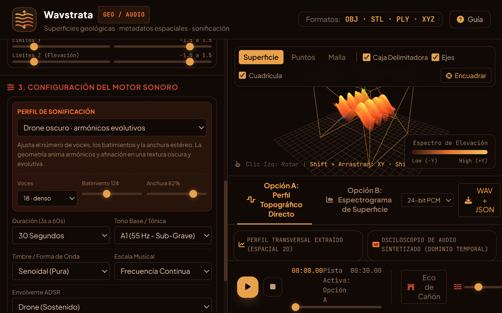

# Wavstrata

**A browser-based geological visualization and sonification studio.**

Wavstrata turns terrain surfaces and point clouds into an interactive 3D view and evolving sound. It is designed for sound and space exploration: users can load a model, inspect and transform its shape, experiment with sound profiles, and export an audio file with a metadata sidecar.

The screenshot shows the app running with the **Dark Ambient** profile, 18 voices, a 12-cent beating setting, and 82% stereo width.

## Open the app

### Online version 

[WAVSTRATA](https://rvx.github.io/wavstrata/Wavstrata.html)

### Shared 3D scan catalog

The online app includes a public catalog of the five scans in `3DSCANS/`. Choose a scan and press **Cargar**; the app downloads only that model from GitHub Pages and then processes it in the browser. The catalog is about **150 MiB** in total. These scan files are public and can be accessed or downloaded by anyone.

### Try it locally

1. Download `Wavstrata.html`.
2. Open it in a current version of Chrome, Edge, or Firefox.
3. Keep an internet connection available so the page can load its visualization, interface, and icon libraries from their CDNs.

No build step, package installation, account, or server is required for local use.

## Workflow

1. In the online app, choose a scan from the public 3D catalog and press **Cargar**, or open a sample preset/load a supported local model.
2. Inspect the surface and adjust position, axis rotations, or crop bounds.
3. Choose a sound profile:
   - **Terrain** maps the geometry into the standard synthesis options.
   - **Strata Drone** makes a slower, low-register layered drone.
   - **Dark Ambient** offers 6–24 voices, adjustable beating/detuning, and stereo width.
4. Compare **Option A** and **Option B**, then play the result.
5. Add site information in the metadata panel if appropriate. Use **WAV** and **JSON** to download the audio and its matching metadata sidecar as separate files. Both filenames share the same base name; download them individually to avoid browser restrictions on multiple automatic downloads.

The metadata sidecar records the audio format, sound settings, model name and transforms, site metadata, and the playback reverb settings. The canyon reverb, low-pass filter, and master-volume controls are for preview and are not applied to the exported WAV.

## Features

- Interactive Three.js 3D terrain and point-cloud viewer.
- Public catalog of five OBJ scans, downloaded one at a time from GitHub Pages.
- OBJ, STL, PLY, and XYZ input support; PLY support is for ASCII files.
- Terrain, strata-drone, and configurable dark-ambient sound profiles.
- Audio preview controls, canyon reverb with mix, pre-delay and decay settings, plus a low-pass filter.
- 16-bit and 24-bit PCM WAV export and its matching JSON metadata sidecar as separate downloads.
- Site metadata saved in the current browser and exportable as JSON.

## Privacy and practical notes

- Wavstrata has no server or analytics backend. Models are processed in the browser; site metadata is stored in that browser's local storage unless exported. The five scans in `3DSCANS/` are hosted publicly on GitHub Pages.
- The page loads third-party libraries and fonts from CDNs, so an internet connection is needed. Avoid entering sensitive site information on a shared device.
- Large geometry files and long, high-resolution drone renders need more browser memory and processing time. Start with a preset or a shorter duration if a device struggles.
- The WAV contains the generated synthesis buffer. Playback-only controls such as the canyon reverb, low-pass filter, and master volume are not baked into the exported audio; the JSON sidecar records the reverb settings.

## Files

- `Wavstrata.html` — the standalone application.
- `wavstrata-screenshot.png` — screenshot of the running application.
- `README.md` — usage and GitHub Pages instructions.
- `3DSCANS/` — public OBJ scan catalog and its `catalog.json` index.

## Contributing

Issues and pull requests are welcome — this is meant to be a small, readable reference implementation for turning 3D scans data into sound, not a polished framework. Feel free to fork it, adapt it for a different scan test, or extend the sonification approach (e.g. pitch-preserving time-stretch, multi-channel stereo mixes, etc.).

## Citation

If this tool is useful in an academic or creative context, a citation or acknowledgment along these lines is appreciated:

    Mazon, V. (2026). Wavstrata Superficies geológicas, metadatos espaciales, sonificación y Toolkit [Software].

## License

Licensed under the GNU General Public License v3.0 — see LICENSE for the full text. In short: you are free to use, study, modify, and redistribute this software (including commercially), provided derivative works are also released under the GPL-3.0 and you preserve the copyright/license notices.

Copyright (C) 2026 Victor Mazon.
